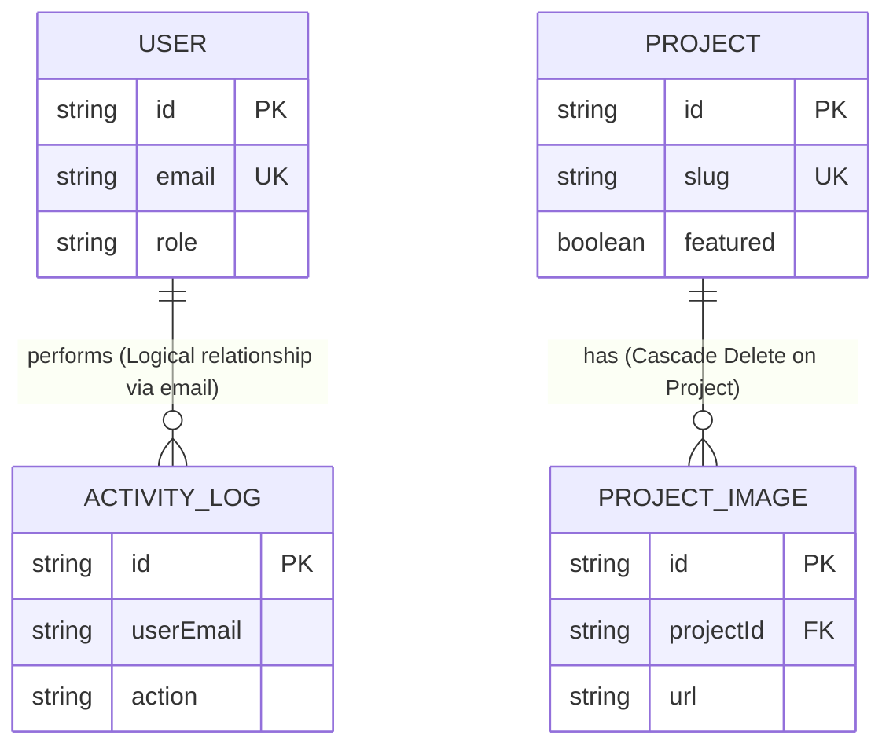

# Database Schema Analysis & System Overview

This document provides a comprehensive analysis of the database schema defined in the project's backend Prisma schema (`backend/prisma/schema.prisma`). It includes detailed information about the tables, relationships, data types, data flow, sample SQL queries, and best practices.

---

## 1. Database & Schema Technology Stack
* **Database Provider**: PostgreSQL
* **ORM (Object-Relational Mapping)**: Prisma Client (`prisma-client-js`)
* **ID Generation Strategy**: UUIDv4 (universally unique identifiers) for all tables
* **Deletion Pattern**: Soft deletes (`deletedAt` timestamp field) implemented on most tables to prevent accidental data loss.

---

## 2. Entity-Relationship (ER) Overview
The system contains **21 tables**. Structurally, the database is highly modular, separating portfolio content, landing page components, user settings, system configurations, and security/audit trails.

### High-Level Relationship Diagram
The physical database constraints focus mainly on core portfolio assets, while logical/application-level relationships associate administrative actions.



---

## 3. Comprehensive Table Inventory & Column Metadata

Below is the exhaustive inventory of all 21 tables in the schema, including their purpose, column count, types, keys, and nullability.

### Table Categorization
1. **Security & Audit Logs**: `User`, `ActivityLog`
2. **Portfolio & Media**: `Project`, `ProjectImage`, `GalleryItem`
3. **Core Landing Page Sections**: `HeroSection`, `AboutSection`, `Achievement`, `ProcessStep`, `WhyChooseUs`, `Service`, `Testimonial`, `TeamMember`, `Partner`, `FAQ`
4. **Inquiries & Communications**: `ContactDetails`, `ContactMessage`, `NewsletterSubscriber`
5. **System & Configurations**: `SEOSettings`, `SystemSettings`

---

### Category A: Security & Audit Logs

#### 1. `User`
* **Purpose**: Stores information about users authorized to log in to the administrative panel.
* **Total Columns**: 8

| Column Name | Prisma Type | PostgreSQL Type | Key Type | Nullability | Default / Extra |
| :--- | :--- | :--- | :--- | :--- | :--- |
| `id` | `String` | `UUID` | **PK** | NOT NULL | `uuid()` |
| `email` | `String` | `VARCHAR` / `TEXT` | **Unique** | NOT NULL | — |
| `password` | `String` | `VARCHAR` / `TEXT` | — | NOT NULL | — |
| `name` | `String` | `VARCHAR` / `TEXT` | — | NOT NULL | — |
| `role` | `String` | `VARCHAR` / `TEXT` | — | NOT NULL | `"ADMIN"` |
| `createdAt` | `DateTime` | `TIMESTAMP` | — | NOT NULL | `now()` |
| `updatedAt` | `DateTime` | `TIMESTAMP` | — | NOT NULL | `updatedAt` (auto-trigger) |
| `deletedAt` | `DateTime?` | `TIMESTAMP` | — | **NULLABLE** | Soft delete |

#### 2. `ActivityLog`
* **Purpose**: Records administrative actions performed inside the portal (e.g. creating/updating projects, changing homepage text).
* **Total Columns**: 5

| Column Name | Prisma Type | PostgreSQL Type | Key Type | Nullability | Default / Extra |
| :--- | :--- | :--- | :--- | :--- | :--- |
| `id` | `String` | `UUID` | **PK** | NOT NULL | `uuid()` |
| `action` | `String` | `VARCHAR` / `TEXT` | — | NOT NULL | e.g., `"CREATED_PROJECT"` |
| `details` | `String` | `VARCHAR` / `TEXT` | — | NOT NULL | Details on the change |
| `userEmail` | `String` | `VARCHAR` / `TEXT` | **Logical FK** | NOT NULL | Links to `User.email` |
| `createdAt` | `DateTime` | `TIMESTAMP` | — | NOT NULL | `now()` |

---

### Category B: Portfolio & Media

#### 3. `Project`
* **Purpose**: Holds details of showcase projects, portfolio designs, or case studies.
* **Total Columns**: 19 (excluding relation arrays)

| Column Name | Prisma Type | PostgreSQL Type | Key Type | Nullability | Default / Extra |
| :--- | :--- | :--- | :--- | :--- | :--- |
| `id` | `String` | `UUID` | **PK** | NOT NULL | `uuid()` |
| `title` | `String` | `VARCHAR` / `TEXT` | — | NOT NULL | — |
| `slug` | `String` | `VARCHAR` / `TEXT` | **Unique** | NOT NULL | URL slug |
| `category` | `String` | `VARCHAR` / `TEXT` | — | NOT NULL | e.g. Residential, Commercial |
| `coverImage` | `String` | `VARCHAR` / `TEXT` | — | NOT NULL | Hero photo URL |
| `clientName` | `String` | `VARCHAR` / `TEXT` | — | NOT NULL | Client brand name |
| `location` | `String` | `VARCHAR` / `TEXT` | — | NOT NULL | City/Country |
| `area` | `String` | `VARCHAR` / `TEXT` | — | NOT NULL | Project dimension / area |
| `completionDate`| `DateTime` | `TIMESTAMP` | — | NOT NULL | Project finish date |
| `status` | `String` | `VARCHAR` / `TEXT` | — | NOT NULL | e.g. "Completed", "In Progress" |
| `description` | `String` | `VARCHAR` / `TEXT` | — | NOT NULL | Main description |
| `designChallenge`| `String` | `VARCHAR` / `TEXT` | — | NOT NULL | Obstacles faced |
| `solution` | `String` | `VARCHAR` / `TEXT` | — | NOT NULL | Implemented solution |
| `materials` | `String` | `VARCHAR` / `TEXT` | — | NOT NULL | Comma-separated tags |
| `featured` | `Boolean` | `BOOLEAN` | — | NOT NULL | `false` |
| `seoTitle` | `String?` | `VARCHAR` / `TEXT` | — | **NULLABLE** | Specific SEO title override |
| `seoDescription`| `String?` | `VARCHAR` / `TEXT` | — | **NULLABLE** | Specific SEO desc override |
| `createdAt` | `DateTime` | `TIMESTAMP` | — | NOT NULL | `now()` |
| `updatedAt` | `DateTime` | `TIMESTAMP` | — | NOT NULL | `updatedAt` |
| `deletedAt` | `DateTime?` | `TIMESTAMP` | — | **NULLABLE** | Soft delete |

#### 4. `ProjectImage`
* **Purpose**: Secondary image slides mapped to individual projects (one-to-many relationship).
* **Total Columns**: 6

| Column Name | Prisma Type | PostgreSQL Type | Key Type | Nullability | Default / Extra |
| :--- | :--- | :--- | :--- | :--- | :--- |
| `id` | `String` | `UUID` | **PK** | NOT NULL | `uuid()` |
| `url` | `String` | `VARCHAR` / `TEXT` | — | NOT NULL | Image CDN/Static URL |
| `order` | `Int` | `INTEGER` | — | NOT NULL | `0` (used for frontend sorting) |
| `projectId` | `String` | `UUID` | **FK** | NOT NULL | References `Project.id` (Cascade) |
| `createdAt` | `DateTime` | `TIMESTAMP` | — | NOT NULL | `now()` |
| `updatedAt` | `DateTime` | `TIMESTAMP` | — | NOT NULL | `updatedAt` |

#### 5. `GalleryItem`
* **Purpose**: General media assets organized into folders (e.g. "Commercial", "Residential") for display in a standalone gallery.
* **Total Columns**: 8

| Column Name | Prisma Type | PostgreSQL Type | Key Type | Nullability | Default / Extra |
| :--- | :--- | :--- | :--- | :--- | :--- |
| `id` | `String` | `UUID` | **PK** | NOT NULL | `uuid()` |
| `type` | `String` | `VARCHAR` / `TEXT` | — | NOT NULL | `"IMAGE"` or `"VIDEO"` |
| `url` | `String` | `VARCHAR` / `TEXT` | — | NOT NULL | File asset URL |
| `category` | `String` | `VARCHAR` / `TEXT` | — | NOT NULL | File category tag |
| `folder` | `String` | `VARCHAR` / `TEXT` | — | NOT NULL | `"root"` (for virtual directory view)|
| `createdAt` | `DateTime` | `TIMESTAMP` | — | NOT NULL | `now()` |
| `updatedAt` | `DateTime` | `TIMESTAMP` | — | NOT NULL | `updatedAt` |
| `deletedAt` | `DateTime?` | `TIMESTAMP` | — | **NULLABLE** | Soft delete |

---

### Category C: Core Landing Page Sections

#### 6. `HeroSection`
* **Purpose**: Configuration of the landing page hero slide.
* **Total Columns**: 10

| Column Name | Prisma Type | PostgreSQL Type | Key Type | Nullability | Default / Extra |
| :--- | :--- | :--- | :--- | :--- | :--- |
| `id` | `String` | `UUID` | **PK** | NOT NULL | `uuid()` |
| `heading` | `String` | `VARCHAR` / `TEXT` | — | NOT NULL | Main visual title |
| `subHeading` | `String` | `VARCHAR` / `TEXT` | — | NOT NULL | Subtitle |
| `backgroundImage`| `String?` | `VARCHAR` / `TEXT` | — | **NULLABLE** | Image background URL |
| `backgroundVideo`| `String?` | `VARCHAR` / `TEXT` | — | **NULLABLE** | Video background URL |
| `ctaText` | `String` | `VARCHAR` / `TEXT` | — | NOT NULL | Button text label |
| `ctaLink` | `String` | `VARCHAR` / `TEXT` | — | NOT NULL | Button redirection target |
| `createdAt` | `DateTime` | `TIMESTAMP` | — | NOT NULL | `now()` |
| `updatedAt` | `DateTime` | `TIMESTAMP` | — | NOT NULL | `updatedAt` |
| `deletedAt` | `DateTime?` | `TIMESTAMP` | — | **NULLABLE** | Soft delete |

#### 7. `AboutSection`
* **Purpose**: Details for the profile/about area (e.g. professional experience description, resume, CV link).
* **Total Columns**: 14

| Column Name | Prisma Type | PostgreSQL Type | Key Type | Nullability | Default / Extra |
| :--- | :--- | :--- | :--- | :--- | :--- |
| `id` | `String` | `UUID` | **PK** | NOT NULL | `uuid()` |
| `name` | `String` | `VARCHAR` / `TEXT` | — | NOT NULL | — |
| `profession` | `String` | `VARCHAR` / `TEXT` | — | NOT NULL | — |
| `about` | `String` | `VARCHAR` / `TEXT` | — | NOT NULL | — |
| `biography` | `String` | `VARCHAR` / `TEXT` | — | NOT NULL | — |
| `experience` | `Int` | `INTEGER` | — | NOT NULL | Number of years |
| `skills` | `String` | `VARCHAR` / `TEXT` | — | NOT NULL | Comma-separated or newline string |
| `vision` | `String` | `VARCHAR` / `TEXT` | — | NOT NULL | Company vision |
| `mission` | `String` | `VARCHAR` / `TEXT` | — | NOT NULL | Company mission |
| `resumeUrl` | `String?` | `VARCHAR` / `TEXT` | — | **NULLABLE** | CV file download link |
| `profileImage` | `String?` | `VARCHAR` / `TEXT` | — | **NULLABLE** | Profile headshot URL |
| `createdAt` | `DateTime` | `TIMESTAMP` | — | NOT NULL | `now()` |
| `updatedAt` | `DateTime` | `TIMESTAMP` | — | NOT NULL | `updatedAt` |
| `deletedAt` | `DateTime?` | `TIMESTAMP` | — | **NULLABLE** | Soft delete |

#### 8. `Achievement`
* **Purpose**: Counters and numeric milestones displayed on the landing page (e.g. happy clients, projects completed).
* **Total Columns**: 8

| Column Name | Prisma Type | PostgreSQL Type | Key Type | Nullability | Default / Extra |
| :--- | :--- | :--- | :--- | :--- | :--- |
| `id` | `String` | `UUID` | **PK** | NOT NULL | `uuid()` |
| `yearsExperience`| `Int` | `INTEGER` | — | NOT NULL | `0` |
| `projectsCompleted`| `Int` | `INTEGER` | — | NOT NULL | `0` |
| `happyClients` | `Int` | `INTEGER` | — | NOT NULL | `0` |
| `awards` | `Int` | `INTEGER` | — | NOT NULL | `0` |
| `createdAt` | `DateTime` | `TIMESTAMP` | — | NOT NULL | `now()` |
| `updatedAt` | `DateTime` | `TIMESTAMP` | — | NOT NULL | `updatedAt` |
| `deletedAt` | `DateTime?` | `TIMESTAMP` | — | **NULLABLE** | Soft delete |

#### 9. `ProcessStep`
* **Purpose**: Flow steps for design, consultation, fabrication, or execution.
* **Total Columns**: 9

| Column Name | Prisma Type | PostgreSQL Type | Key Type | Nullability | Default / Extra |
| :--- | :--- | :--- | :--- | :--- | :--- |
| `id` | `String` | `UUID` | **PK** | NOT NULL | `uuid()` |
| `stepNumber` | `Int` | `INTEGER` | — | NOT NULL | Flow sequence order (1, 2, 3, etc.) |
| `title` | `String` | `VARCHAR` / `TEXT` | — | NOT NULL | Title of phase |
| `description` | `String` | `VARCHAR` / `TEXT` | — | NOT NULL | Core summary |
| `icon` | `String` | `VARCHAR` / `TEXT` | — | NOT NULL | SVG code or icon name class |
| `createdAt` | `DateTime` | `TIMESTAMP` | — | NOT NULL | `now()` |
| `updatedAt` | `DateTime` | `TIMESTAMP` | — | NOT NULL | `updatedAt` |
| `deletedAt` | `DateTime?` | `TIMESTAMP` | — | **NULLABLE** | Soft delete |

#### 10. `WhyChooseUs`
* **Purpose**: List of key highlights representing value propositions.
* **Total Columns**: 8

| Column Name | Prisma Type | PostgreSQL Type | Key Type | Nullability | Default / Extra |
| :--- | :--- | :--- | :--- | :--- | :--- |
| `id` | `String` | `UUID` | **PK** | NOT NULL | `uuid()` |
| `icon` | `String` | `VARCHAR` / `TEXT` | — | NOT NULL | SVG details or font-icon class |
| `title` | `String` | `VARCHAR` / `TEXT` | — | NOT NULL | Core heading |
| `description` | `String` | `VARCHAR` / `TEXT` | — | NOT NULL | Justification description |
| `createdAt` | `DateTime` | `TIMESTAMP` | — | NOT NULL | `now()` |
| `updatedAt` | `DateTime` | `TIMESTAMP` | — | NOT NULL | `updatedAt` |
| `deletedAt` | `DateTime?` | `TIMESTAMP` | — | **NULLABLE** | Soft delete |

#### 11. `Service`
* **Purpose**: Individual list of core commercial offerings.
* **Total Columns**: 11

| Column Name | Prisma Type | PostgreSQL Type | Key Type | Nullability | Default / Extra |
| :--- | :--- | :--- | :--- | :--- | :--- |
| `id` | `String` | `UUID` | **PK** | NOT NULL | `uuid()` |
| `title` | `String` | `VARCHAR` / `TEXT` | — | NOT NULL | Service title |
| `icon` | `String` | `VARCHAR` / `TEXT` | — | NOT NULL | Visual icon key |
| `shortDescription`| `String` | `VARCHAR` / `TEXT` | — | NOT NULL | Summary text |
| `fullDescription`| `String` | `VARCHAR` / `TEXT` | — | NOT NULL | Expanded detailed description |
| `image` | `String?`| `VARCHAR` / `TEXT` | — | **NULLABLE** | Explanatory banner image URL |
| `displayOrder` | `Int` | `INTEGER` | — | NOT NULL | `0` (used for custom ordering) |
| `isActive` | `Boolean` | `BOOLEAN` | — | NOT NULL | `true` (enables dynamic toggle) |
| `createdAt` | `DateTime` | `TIMESTAMP` | — | NOT NULL | `now()` |
| `updatedAt` | `DateTime` | `TIMESTAMP` | — | NOT NULL | `updatedAt` |
| `deletedAt` | `DateTime?` | `TIMESTAMP` | — | **NULLABLE** | Soft delete |

#### 12. `Testimonial`
* **Purpose**: Customer quotes, review copy, and satisfaction scoring.
* **Total Columns**: 11

| Column Name | Prisma Type | PostgreSQL Type | Key Type | Nullability | Default / Extra |
| :--- | :--- | :--- | :--- | :--- | :--- |
| `id` | `String` | `UUID` | **PK** | NOT NULL | `uuid()` |
| `clientName` | `String` | `VARCHAR` / `TEXT` | — | NOT NULL | Name of reviewer |
| `company` | `String` | `VARCHAR` / `TEXT` | — | NOT NULL | Reviewer's company |
| `designation` | `String` | `VARCHAR` / `TEXT` | — | NOT NULL | Professional title |
| `profileImage` | `String?`| `VARCHAR` / `TEXT` | — | **NULLABLE** | Avatar photo URL |
| `rating` | `Int` | `INTEGER` | — | NOT NULL | `5` (1 to 5 star rating scale) |
| `review` | `String` | `VARCHAR` / `TEXT` | — | NOT NULL | Content |
| `isActive` | `Boolean` | `BOOLEAN` | — | NOT NULL | `true` |
| `createdAt` | `DateTime` | `TIMESTAMP` | — | NOT NULL | `now()` |
| `updatedAt` | `DateTime` | `TIMESTAMP` | — | NOT NULL | `updatedAt` |
| `deletedAt` | `DateTime?` | `TIMESTAMP` | — | **NULLABLE** | Soft delete |

#### 13. `TeamMember`
* **Purpose**: Profiles and contact paths for firm staff.
* **Total Columns**: 12

| Column Name | Prisma Type | PostgreSQL Type | Key Type | Nullability | Default / Extra |
| :--- | :--- | :--- | :--- | :--- | :--- |
| `id` | `String` | `UUID` | **PK** | NOT NULL | `uuid()` |
| `name` | `String` | `VARCHAR` / `TEXT` | — | NOT NULL | — |
| `position` | `String` | `VARCHAR` / `TEXT` | — | NOT NULL | Corporate/Creative Role |
| `photo` | `String?`| `VARCHAR` / `TEXT` | — | **NULLABLE** | Portrait image URL |
| `bio` | `String` | `VARCHAR` / `TEXT` | — | NOT NULL | Description |
| `facebook` | `String?`| `VARCHAR` / `TEXT` | — | **NULLABLE** | Social URL |
| `twitter` | `String?`| `VARCHAR` / `TEXT` | — | **NULLABLE** | Social URL |
| `linkedin` | `String?`| `VARCHAR` / `TEXT` | — | **NULLABLE** | Social URL |
| `instagram` | `String?`| `VARCHAR` / `TEXT` | — | **NULLABLE** | Social URL |
| `createdAt` | `DateTime` | `TIMESTAMP` | — | NOT NULL | `now()` |
| `updatedAt` | `DateTime` | `TIMESTAMP` | — | NOT NULL | `updatedAt` |
| `deletedAt` | `DateTime?` | `TIMESTAMP` | — | **NULLABLE** | Soft delete |

#### 14. `Partner`
* **Purpose**: Keeps trace of partner organizations, clients, or suppliers logos.
* **Total Columns**: 7

| Column Name | Prisma Type | PostgreSQL Type | Key Type | Nullability | Default / Extra |
| :--- | :--- | :--- | :--- | :--- | :--- |
| `id` | `String` | `UUID` | **PK** | NOT NULL | `uuid()` |
| `companyName` | `String` | `VARCHAR` / `TEXT` | — | NOT NULL | Brand Name |
| `logo` | `String` | `VARCHAR` / `TEXT` | — | NOT NULL | Logo image URL |
| `websiteUrl` | `String?`| `VARCHAR` / `TEXT` | — | **NULLABLE** | Redirect link |
| `createdAt` | `DateTime` | `TIMESTAMP` | — | NOT NULL | `now()` |
| `updatedAt` | `DateTime` | `TIMESTAMP` | — | NOT NULL | `updatedAt` |
| `deletedAt` | `DateTime?` | `TIMESTAMP` | — | **NULLABLE** | Soft delete |

#### 15. `FAQ`
* **Purpose**: Question and answer content lists.
* **Total Columns**: 7

| Column Name | Prisma Type | PostgreSQL Type | Key Type | Nullability | Default / Extra |
| :--- | :--- | :--- | :--- | :--- | :--- |
| `id` | `String` | `UUID` | **PK** | NOT NULL | `uuid()` |
| `question` | `String` | `VARCHAR` / `TEXT` | — | NOT NULL | — |
| `answer` | `String` | `VARCHAR` / `TEXT` | — | NOT NULL | — |
| `displayOrder` | `Int` | `INTEGER` | — | NOT NULL | `0` |
| `createdAt` | `DateTime` | `TIMESTAMP` | — | NOT NULL | `now()` |
| `updatedAt` | `DateTime` | `TIMESTAMP` | — | NOT NULL | `updatedAt` |
| `deletedAt` | `DateTime?` | `TIMESTAMP` | — | **NULLABLE** | Soft delete |

#### 16. `BlogPost`
* **Purpose**: Blog entries with rich content editing formatting support and SEO optimization properties.
* **Total Columns**: 14

| Column Name | Prisma Type | PostgreSQL Type | Key Type | Nullability | Default / Extra |
| :--- | :--- | :--- | :--- | :--- | :--- |
| `id` | `String` | `UUID` | **PK** | NOT NULL | `uuid()` |
| `title` | `String` | `VARCHAR` / `TEXT` | — | NOT NULL | Article title |
| `slug` | `String` | `VARCHAR` / `TEXT` | **Unique** | NOT NULL | URL-safe slug |
| `category` | `String` | `VARCHAR` / `TEXT` | — | NOT NULL | e.g. "Design Trends" |
| `tags` | `String` | `VARCHAR` / `TEXT` | — | NOT NULL | Comma-separated text list |
| `featuredImage`| `String` | `VARCHAR` / `TEXT` | — | NOT NULL | Blog thumbnail image URL |
| `richText` | `String` | `VARCHAR` / `TEXT` | — | NOT NULL | HTML markup/Markdown payload |
| `seoTitle` | `String?`| `VARCHAR` / `TEXT` | — | **NULLABLE** | Specific tag override |
| `seoDescription`| `String?`| `VARCHAR` / `TEXT` | — | **NULLABLE** | Meta tag override |
| `publishDate` | `DateTime` | `TIMESTAMP` | — | NOT NULL | `now()` |
| `createdAt` | `DateTime` | `TIMESTAMP` | — | NOT NULL | `now()` |
| `updatedAt` | `DateTime` | `TIMESTAMP` | — | NOT NULL | `updatedAt` |
| `deletedAt` | `DateTime?` | `TIMESTAMP` | — | **NULLABLE** | Soft delete |

---

### Category D: Inquiries & Communications

#### 17. `ContactDetails`
* **Purpose**: Contact information for address, telephone, map markers, and direct social URLs.
* **Total Columns**: 15

| Column Name | Prisma Type | PostgreSQL Type | Key Type | Nullability | Default / Extra |
| :--- | :--- | :--- | :--- | :--- | :--- |
| `id` | `String` | `UUID` | **PK** | NOT NULL | `uuid()` |
| `officeAddress` | `String` | `VARCHAR` / `TEXT` | — | NOT NULL | Main address |
| `email` | `String` | `VARCHAR` / `TEXT` | — | NOT NULL | Primary contact inbox |
| `phone` | `String` | `VARCHAR` / `TEXT` | — | NOT NULL | Main number |
| `whatsApp` | `String?`| `VARCHAR` / `TEXT` | — | **NULLABLE** | Direct chat link |
| `googleMapsUrl` | `String?`| `VARCHAR` / `TEXT` | — | **NULLABLE** | Google Maps iframe/share URL |
| `workingHours` | `String?`| `VARCHAR` / `TEXT` | — | **NULLABLE** | Hours copy string |
| `socialFacebook`| `String?`| `VARCHAR` / `TEXT` | — | **NULLABLE** | URL |
| `socialTwitter` | `String?`| `VARCHAR` / `TEXT` | — | **NULLABLE** | URL |
| `socialLinkedin`| `String?`| `VARCHAR` / `TEXT` | — | **NULLABLE** | URL |
| `socialInsta` | `String?`| `VARCHAR` / `TEXT` | — | **NULLABLE** | URL |
| `createdAt` | `DateTime` | `TIMESTAMP` | — | NOT NULL | `now()` |
| `updatedAt` | `DateTime` | `TIMESTAMP` | — | NOT NULL | `updatedAt` |
| `deletedAt` | `DateTime?` | `TIMESTAMP` | — | **NULLABLE** | Soft delete |

#### 18. `ContactMessage`
* **Purpose**: Collects messages sent by users from frontend contact forms.
* **Total Columns**: 11

| Column Name | Prisma Type | PostgreSQL Type | Key Type | Nullability | Default / Extra |
| :--- | :--- | :--- | :--- | :--- | :--- |
| `id` | `String` | `UUID` | **PK** | NOT NULL | `uuid()` |
| `name` | `String` | `VARCHAR` / `TEXT` | — | NOT NULL | Sender name |
| `phone` | `String` | `VARCHAR` / `TEXT` | — | NOT NULL | Sender phone |
| `email` | `String` | `VARCHAR` / `TEXT` | — | NOT NULL | Sender email |
| `subject` | `String` | `VARCHAR` / `TEXT` | — | NOT NULL | Message subject |
| `message` | `String` | `VARCHAR` / `TEXT` | — | NOT NULL | Message body |
| `status` | `String` | `VARCHAR` / `TEXT` | — | NOT NULL | `"UNREAD"` (UNREAD/READ/REPLIED) |
| `createdAt` | `DateTime` | `TIMESTAMP` | — | NOT NULL | `now()` |
| `updatedAt` | `DateTime` | `TIMESTAMP` | — | NOT NULL | `updatedAt` |
| `deletedAt` | `DateTime?` | `TIMESTAMP` | — | **NULLABLE** | Soft delete |

#### 19. `NewsletterSubscriber`
* **Purpose**: Holds email addresses registered for the newsletter service.
* **Total Columns**: 5

| Column Name | Prisma Type | PostgreSQL Type | Key Type | Nullability | Default / Extra |
| :--- | :--- | :--- | :--- | :--- | :--- |
| `id` | `String` | `UUID` | **PK** | NOT NULL | `uuid()` |
| `email` | `String` | `VARCHAR` / `TEXT` | **Unique** | NOT NULL | — |
| `createdAt` | `DateTime` | `TIMESTAMP` | — | NOT NULL | `now()` |
| `updatedAt` | `DateTime` | `TIMESTAMP` | — | NOT NULL | `updatedAt` |
| `deletedAt` | `DateTime?` | `TIMESTAMP` | — | **NULLABLE** | Soft delete |

---

### Category E: System Configurations

#### 20. `SEOSettings`
* **Purpose**: General homepage search optimization meta values, scripts, and analytical tracking IDs.
* **Total Columns**: 9

| Column Name | Prisma Type | PostgreSQL Type | Key Type | Nullability | Default / Extra |
| :--- | :--- | :--- | :--- | :--- | :--- |
| `id` | `String` | `UUID` | **PK** | NOT NULL | `uuid()` |
| `homepageTitle` | `String` | `VARCHAR` / `TEXT` | — | NOT NULL | — |
| `metaDescription`| `String` | `VARCHAR` / `TEXT` | — | NOT NULL | — |
| `keywords` | `String` | `VARCHAR` / `TEXT` | — | NOT NULL | Comma-separated |
| `ogImage` | `String?`| `VARCHAR` / `TEXT` | — | **NULLABLE** | OpenGraph image |
| `googleAnalyticsId`| `String?`| `VARCHAR` / `TEXT` | — | **NULLABLE** | Analytics Tag ID |
| `searchConsoleVerification`| `String?`| `VARCHAR` / `TEXT` | — | **NULLABLE** | Verification meta tag |
| `createdAt` | `DateTime` | `TIMESTAMP` | — | NOT NULL | `now()` |
| `updatedAt` | `DateTime` | `TIMESTAMP` | — | NOT NULL | `updatedAt` |
| `deletedAt` | `DateTime?` | `TIMESTAMP` | — | **NULLABLE** | Soft delete |

#### 21. `SystemSettings`
* **Purpose**: Core application properties (logo, colors, maintenance modes).
* **Total Columns**: 10

| Column Name | Prisma Type | PostgreSQL Type | Key Type | Nullability | Default / Extra |
| :--- | :--- | :--- | :--- | :--- | :--- |
| `id` | `String` | `UUID` | **PK** | NOT NULL | `uuid()` |
| `websiteLogo` | `String?`| `VARCHAR` / `TEXT` | — | **NULLABLE** | Main logo URL |
| `favicon` | `String?`| `VARCHAR` / `TEXT` | — | **NULLABLE** | App shortcut icon URL |
| `themeColors` | `String` | `VARCHAR` / `TEXT` | — | NOT NULL | `"default"` |
| `footerText` | `String?`| `VARCHAR` / `TEXT` | — | **NULLABLE** | Custom copyright text |
| `maintenanceMode`| `Boolean`| `BOOLEAN` | — | NOT NULL | `false` |
| `timezone` | `String` | `VARCHAR` / `TEXT` | — | NOT NULL | `"UTC"` |
| `language` | `String` | `VARCHAR` / `TEXT` | — | NOT NULL | `"en"` |
| `createdAt` | `DateTime` | `TIMESTAMP` | — | NOT NULL | `now()` |
| `updatedAt` | `DateTime` | `TIMESTAMP` | — | NOT NULL | `updatedAt` |
| `deletedAt` | `DateTime?` | `TIMESTAMP` | — | **NULLABLE** | Soft delete |

---

## 4. Key Relationships & Cardinality

### 1. Project to ProjectImage (Physical Relationship)
* **Type**: One-to-Many (`1 : N`)
* **Foreign Key**: `ProjectImage.projectId` references `Project.id`
* **OnDelete Directive**: `Cascade` (if a Project is deleted, all its associated ProjectImages are automatically deleted by the database).
* **Join Condition**: 
  ```sql
  FROM "Project" p
  JOIN "ProjectImage" pi ON p.id = pi."projectId"
  ```

### 2. User to ActivityLog (Logical Relationship)
* **Type**: One-to-Many (`1 : N`)
* **Matching Fields**: `ActivityLog.userEmail` matches `User.email`
* **Note**: No physical foreign key is enforced at the database layer (non-constrained logical relation). This avoids blocking delete queries on users if their audit logs need to be kept indefinitely.
* **Join Condition**:
  ```sql
  FROM "User" u
  JOIN "ActivityLog" al ON u.email = al."userEmail"
  ```

---

## 5. Main Data Flows
```
Visitor Submissions:
[Visitor] ---> (Submits contact form) ---> INSERT INTO "ContactMessage" (UNREAD)
[Visitor] ---> (Submits email input)  ---> INSERT INTO "NewsletterSubscriber"

Portfolio Management:
[Admin User] ---> (Creates new Project) ---> INSERT INTO "Project"
            ---> (Uploads gallery slides) ---> INSERT INTO "ProjectImage" (FK: projectId)
            ---> (Triggers log)          ---> INSERT INTO "ActivityLog" (userEmail = adminEmail)

Landing Page Customization:
[Admin User] ---> (Updates core blocks) ---> UPDATE "HeroSection" / "AboutSection" / "Service"
            ---> (Triggers log)          ---> INSERT INTO "ActivityLog"
```

---

## 6. Sample SQL CRUD Operations

### A. Data Retrieval (SELECT & JOINs)

#### 1. Retrieve a Project with its Images (One-to-Many JOIN)
Retrieves all details for a project using its URL slug, including any uploaded secondary photos.
```sql
SELECT 
    p.id, 
    p.title, 
    p.category, 
    p.status, 
    pi.id AS image_id, 
    pi.url AS image_url, 
    pi."order" AS image_order
FROM "Project" p
LEFT JOIN "ProjectImage" pi ON p.id = pi."projectId"
WHERE p.slug = 'modern-villa-residence' 
  AND p."deletedAt" IS NULL
ORDER BY pi."order" ASC;
```

#### 2. Audit Trail: Admin Activity Logs (Logical JOIN)
Retrieves system activity logs joined with user details.
```sql
SELECT 
    al.id AS log_id, 
    u.name AS admin_name, 
    al.userEmail AS admin_email, 
    al.action, 
    al.details, 
    al.createdAt AS timestamp
FROM "ActivityLog" al
INNER JOIN "User" u ON al."userEmail" = u.email
WHERE u."deletedAt" IS NULL
ORDER BY al."createdAt" DESC
LIMIT 50;
```

#### 3. Select Active Services (Filtered & Sorted)
Retrieves the list of active services ordered by display priorities.
```sql
SELECT id, title, icon, shortDescription, displayOrder 
FROM "Service"
WHERE "isActive" = TRUE 
  AND "deletedAt" IS NULL
ORDER BY "displayOrder" ASC;
```

---

### B. Data Insertion (INSERT)

#### 1. Add a New Administrative User
```sql
INSERT INTO "User" (id, email, password, name, role, "createdAt", "updatedAt")
VALUES (
    'a5b46d78-9e12-4c56-8fde-f1a2b3c4d5e6', 
    'admin@dacorridor.com', 
    '$2b$10$Un0tHIsIsAPasswordHashValueStringHere...', -- BCrypt Hash
    'John Administrator', 
    'ADMIN', 
    CURRENT_TIMESTAMP, 
    CURRENT_TIMESTAMP
);
```

#### 2. Submit a New Contact Message
```sql
INSERT INTO "ContactMessage" (id, name, phone, email, subject, message, status, "createdAt", "updatedAt")
VALUES (
    'c7d8e9fa-b012-4c34-8d56-e7f8a9b0c1d2',
    'Jane Doe',
    '+1234567890',
    'janedoe@example.com',
    'Consultation Inquiry',
    'Hello, I would like to schedule a consultation for an interior design project.',
    'UNREAD',
    CURRENT_TIMESTAMP,
    CURRENT_TIMESTAMP
);
```

---

### C. Data Modification (UPDATE)

#### 1. Update the Website Title and Analytics ID
```sql
UPDATE "SEOSettings"
SET 
    "homepageTitle" = 'Da’ Corridor - Premium Interior Architecture & Design Portfolio',
    "googleAnalyticsId" = 'G-XXXXXXXXXX',
    "updatedAt" = CURRENT_TIMESTAMP
WHERE id = 'e8c7d6b5-a4b3-4c2d-1e0f-9a8b7c6d5e4f';
```

#### 2. Feature/Highlight a Specific Project
```sql
UPDATE "Project"
SET 
    featured = TRUE,
    "updatedAt" = CURRENT_TIMESTAMP
WHERE slug = 'luxury-penthouse-design' 
  AND "deletedAt" IS NULL;
```

---

### D. Data Deletion (Soft vs. Hard DELETE)

#### 1. Soft Delete a Project (Recommended)
Flags a project as deleted without removing its actual record, preserving relational integrity.
```sql
UPDATE "Project"
SET "deletedAt" = CURRENT_TIMESTAMP
WHERE id = 'f7e6d5c4-b3a2-4c1d-0e9f-8a7b6c5d4e3f';
```

#### 2. Hard Delete an Expired Partner Logo (Direct Deletion)
```sql
DELETE FROM "Partner"
WHERE id = '9a8b7c6d-5e4f-3a2b-1c0d-e9f8a7b6c5d4';
```

---

## 7. SQL Execution Best Practices

Before running write operations (`UPDATE` or `DELETE`) on production databases, follow these critical safety precautions:

### 1. Never Omit the `WHERE` Clause
Omitting the `WHERE` clause runs the operation against **every** record in the table.
* **Bad**: `DELETE FROM "User";` (Wipes out all users)
* **Good**: `DELETE FROM "User" WHERE id = 'uuid-string';`

### 2. Verify with `SELECT` First
Before updating or deleting records, write a `SELECT` statement using the exact same filters to inspect the target dataset.
* **Step 1 (Check)**:
  ```sql
  SELECT id, title, featured FROM "Project" WHERE "completionDate" < '2023-01-01';
  ```
* **Step 2 (Execute)**:
  ```sql
  UPDATE "Project" SET featured = FALSE WHERE "completionDate" < '2023-01-01';
  ```

### 3. Use Database Transactions
Wrap multi-table modifications or critical queries inside database transactions. If any command fails, roll back the whole statement to prevent partial updates.
```sql
BEGIN;

-- Run statements
UPDATE "Project" SET status = 'Archived' WHERE id = 'some-uuid';
UPDATE "ProjectImage" SET url = 'placeholder.jpg' WHERE "projectId" = 'some-uuid';

-- Verify counts, then commit
COMMIT;
-- (Or run ROLLBACK; if anything is incorrect)
```

### 4. Prefer Soft Deletes
The schema implements a `deletedAt` (`TIMESTAMP NULLABLE`) field on most tables. 
* Avoid using standard `DELETE` statements.
* Instead, perform an `UPDATE` setting `deletedAt = CURRENT_TIMESTAMP`.
* Exclude soft-deleted rows in application queries using: `WHERE "deletedAt" IS NULL`.

### 5. Perform Database Backups
Before doing bulk updates, execute a database snapshot backup:
```bash
pg_dump -U postgres -d dacorridor_db > backup_before_migration.sql
```
