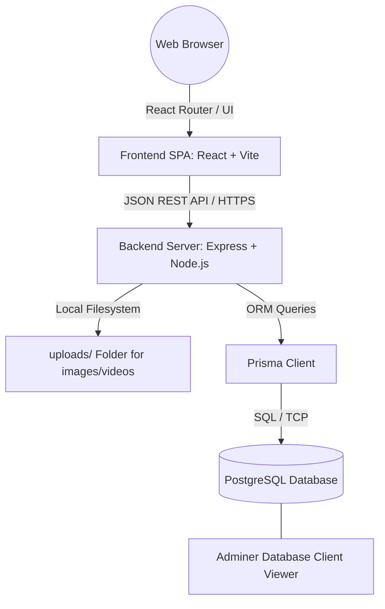

# System Architecture & Technical E-Report
This e-report outlines the software architecture, technical stack, key API fetchers, database configuration, and directories of the Architecture CMS web application.

---

## 1. System Architecture Overview

The system is built on a modern **three-tier architecture** designed for high responsiveness, SEO optimization, and premium user interaction.



### 1.1 Client Tier (Frontend)
- **Framework:** React 18 (SPA) scaffolded with Vite.
- **Routing:** React Router DOM (supports public layouts vs. protected admin layouts).
- **Styling:** Tailwind CSS for fluid responsive grids and modern UI design.
- **Icons:** Lucide React for consistent vector icons.

### 1.2 Application Tier (Backend)
- **Platform:** Node.js running an Express server.
- **ORM:** Prisma ORM to interact with the database.
- **Auth:** JWT (JSON Web Tokens) with passwords hashed via BcryptJS.
- **File Uploads:** Multer middleware to stream and store files directly into the local `/uploads/` directory.

### 1.3 Database Tier
- **Engine:** PostgreSQL instance managed inside a Docker container.
- **Port:** `5432` for connection, with Adminer UI mapped to port `8080`.

---

## 2. Key API Fetchers & Routing Map

The frontend communicates with the backend REST API via standard endpoints located in the backend controllers. Below is a map of the primary endpoints:

### 2.1 Authentication & Profile
- **`POST /api/auth/login`**: Authenticates user credentials and returns a secure JWT.
- **`GET /api/auth/me`**: Fetches the profile details of the currently authenticated administrator.

### 2.2 Portfolio & Projects
- **`GET /api/portfolio`**: Public endpoint to retrieve all active design projects.
- **`POST /api/portfolio`**: (Protected) Add a new project with images, metadata, and description.
- **`PUT /api/portfolio/:id`**: (Protected) Update project attributes.
- **`DELETE /api/portfolio/:id`**: (Protected) Soft-delete a project (sets `deletedAt` column).

### 2.3 Services Page
- **`GET /api/service`**: Retrieve the catalog of architect services.
- **`POST /api/service`** / **`PUT /api/service/:id`**: (Protected) Manage services lists.

### 2.4 Media Library
- **`POST /api/gallery`**: (Protected) Upload new image/video assets using Multer.
- **`GET /api/gallery`**: Retrieve all media files.
- **`DELETE /api/gallery/:id`**: (Protected) Remove media metadata and delete the files from storage.

### 2.5 Inquiries & Comments
- **`POST /api/contact/message`**: Public submission of contact inquiries.
- **`GET /api/contact/messages`**: (Protected) Retrieve the inbox of inquiries.
- **`POST /api/testimonial`**: Public submission of customer feedback.
- **`GET /api/testimonial`**: Fetch approved testimonials.
- **`PUT /api/testimonial/:id/approve`**: (Protected) Approve a testimonial for public viewing.

---

## 3. Directory Structure

```text
Da’ Corridor/
├── backend/                       # Express Node.js API server
│   ├── prisma/                    # Schema models, migrations, and seed scripts
│   ├── src/                       # Main backend source files
│   │   ├── controllers/           # Request handlers and business logic
│   │   ├── middleware/            # JWT validation and multer file configuration
│   │   ├── routes/                # Express API router hooks
│   │   └── server.js              # Entrypoint server script
│   └── uploads/                   # Physical directory hosting user-uploaded images/videos
├── frontend/                      # React.js client single-page app
│   ├── src/
│   │   ├── components/            # Layouts and reusable widgets
│   │   ├── context/               # Global state (Authentication, etc.)
│   │   ├── pages/                 # Admin page components
│   │   │   └── client/            # Public-facing page views (Home, About, Contact, etc.)
│   │   └── main.jsx               # Entrypoint source file
│   └── index.html                 # Core HTML viewport document
├── docker-compose.yml             # Docker config for local PostgreSQL & Adminer
└── README.md                      # Overall setup documentation
```
